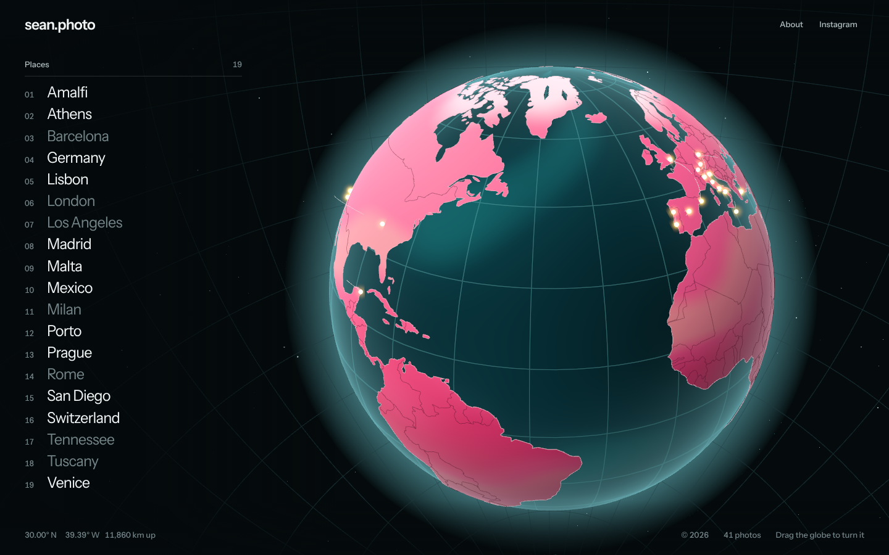
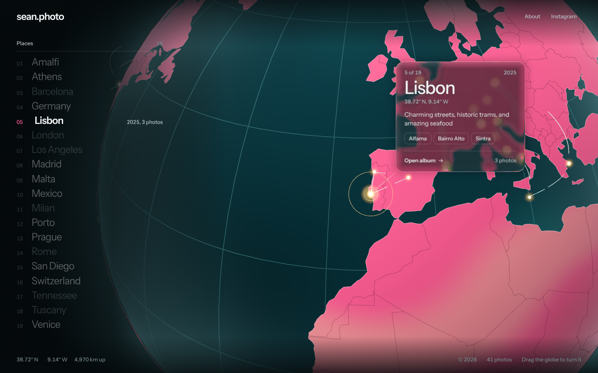
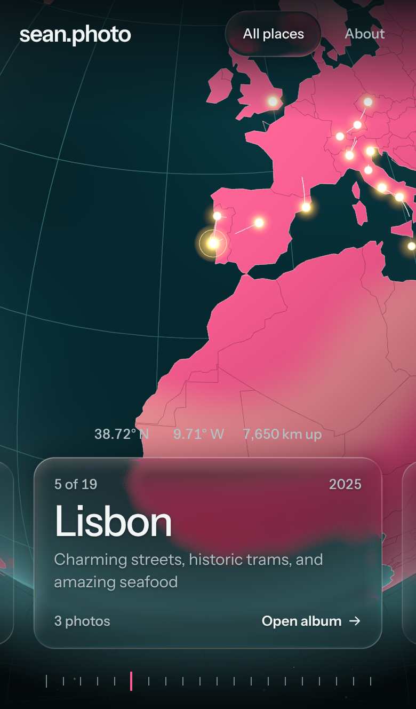
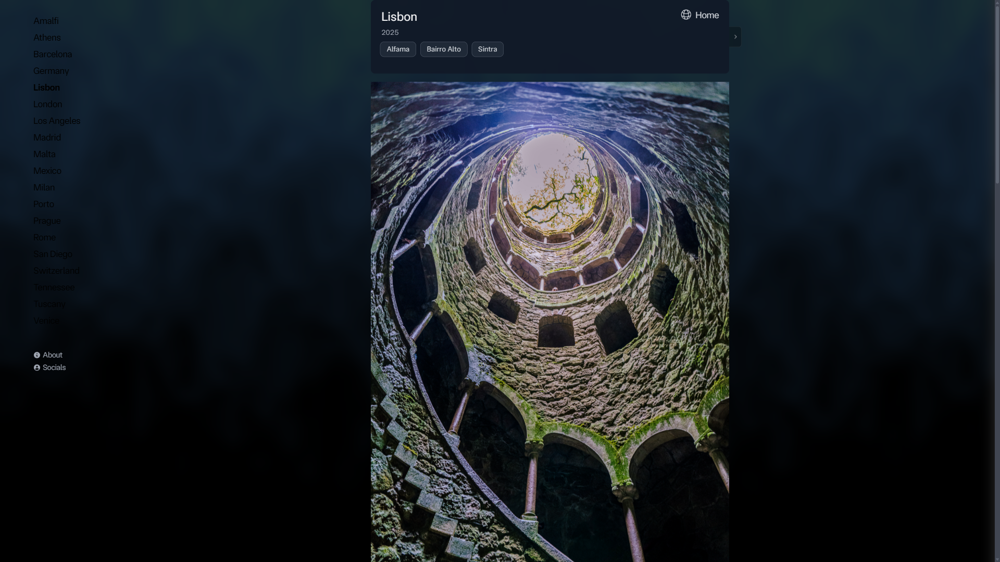

# Photos

A travel photography portfolio that lets you browse a collection of photos from around the globe. Click a photo on the rotating 3D globe and you land in a gallery for that destination, with EXIF details on every shot. HDR images lean on the browser's own tone mapping rather than faking it with CSS filters.

## Screenshots

Home page with the interactive globe:



A place in focus. The callout is real glass: it refracts the globe under it.



On a phone the places become a deck of cards to swipe through:



An album page with the photo gallery:



## Features

* A 3D globe you can turn, with every destination a point of light. Hover or tap a place and the camera flies there; open it and the camera dives in
* Two layouts picked by the shape of the screen: a list beside the globe on wide screens, a swipeable deck under it on phones
* Liquid glass panels that refract the globe beneath them, drawn in WebGL so they look the same in Safari, Firefox and Chrome
* HDR capable images, so the browser handles tone mapping instead of CSS filters faking it
* Photos that start loading from the first bytes of the page, in a size that fits the screen once the bucket has variants (see below)
* EXIF badges on hover that show focal length, aperture, shutter speed, and ISO
* Albums organized geographically and served from a Cloudflare R2 bucket
* Runs as a static site or with server rendering

## Tech stack

* Next.js 16 with the App Router, React 19
* TypeScript
* Tailwind CSS 4
* three.js with react-globe.gl for the main globe, and Cobe for the small globe on the about page
* framer-motion for animation
* Instrument Sans, self-hosted as one variable font file
* sharp and libavif for the image optimization scripts

## Getting started

You need Node.js 20.19 or newer (CI uses 22).

```sh
git clone https://github.com/21sean/photos.git
cd photos
npm install
npm run dev
```

Once the dev server is up, open http://localhost:3000 in your browser.

## Scripts

* `npm run dev` starts the development server
* `npm run build` builds the app for production
* `npm run build:static` produces a static export at `out/`
* `npm run start` serves a production build
* `npm run lint` runs ESLint
* `npm run check` compiles TypeScript without emitting anything
* `npm run format` and `npm run format:fix` check and fix formatting with Prettier
* `npm run knip` reports unused files, exports, and dependencies

## Project structure

```
src/
  app/                Next.js App Router pages
    [slug]/           album pages (server page plus client view)
    about/            about page
    layout.tsx        root layout, fonts and metadata
    page.tsx          home page
    globals.css       design tokens, base styles, album and photo styles
  lib/
    albums.ts         album metadata (titles, coordinates, cities)
    photos.ts         loads the generated photos.json manifest
    data.ts           album accessors used by the album pages
    destinations.ts   the slim per-album summary the home page ships
    slug.ts           turns a title into a URL slug
    r2.ts             builds Cloudflare R2 image URLs and srcsets
    nav.tsx           album page navigation
    landing/          home page UI: list, card deck, callout, sheet, styles
    globe/            the globe itself
      globe-canvas.tsx  the WebGL scene, camera, markers and picking
      theme.ts          every colour of the globe, in one place
      materials.ts      sea and land shaders
      scene.ts          stars, markers, borders, graticule
      glass.ts          the liquid glass pass
      camera.ts, arcs.ts
      mini-globe.tsx    the small globe on the about page
    images/           gallery, photo element, layout sizes, iOS memory cleanup
    fx/               canvas and shader backgrounds, scroll reveal, noise
    icons/            small SVG icons
  data/               country outlines for the globe
  types/              shared TypeScript types
  fonts/              the variable font and its licence
```

### Restyling the home page

* The globe's colours all live in `src/lib/globe/theme.ts`.
* Where the globe sits and how big it is are plain CSS: the `.globe-frame` box and the `--globe-*` properties at the top of `src/lib/landing/landing.css`. The canvas reads that box and points the camera to match.
* Any element with a `data-glass` attribute inside the home page becomes a glass panel. It needs a `border-radius`; the pass reads its box each frame.

## Photo data

Your photos live in a Cloudflare R2 bucket. Album metadata is entered by hand in `src/lib/albums.ts`, while the photo list for each album is read from `src/lib/photos.json`, which is generated from the bucket rather than edited directly.

### Rebuilding the manifest

```sh
npm run sync:photos
```

This runs `scripts/sync-photos.js`, which lists the bucket, pulls EXIF and HDR metadata (dimensions, ISO, aperture, shutter speed, focal length, date, and GPS when present), and writes `src/lib/photos.json`. It also records which downscaled variants exist for each photo (`variants`) and a tiny blurred preview (`lqip`) that the gallery shows while the photo loads. Fields added by other tools, such as AI descriptions, survive a re-sync.

```sh
node scripts/sync-photos.js --quick    # skip EXIF for speed
node scripts/sync-photos.js --dry-run  # preview without writing
```

### Web optimized images

Original images in the bucket can be heavy, so the optimizer builds AVIF copies under a `web/` prefix and keeps wide gamut and HDR color wherever it can. For every photo it writes:

* a size capped master at `web/{album}/{name}.avif`, as large as fits in 5 MB
* downscaled variants at `web/{album}/{name}-{width}w.avif`, for widths 800, 1280, 1920 and 2880 (never upscaled)

The masters can be tens of megapixels, which is far more than a phone needs. Once variants exist and the manifest has been rebuilt, the site serves them through `srcset`, so each screen downloads a file that fits it. Until then it keeps using the masters, exactly as before.

```sh
npm run optimize:web         # encode and upload whatever is missing
npm run optimize:web:dry     # preview only
npm run optimize:web:force   # overwrite what is already there
npm run sync:photos          # then rebuild the manifest so the site sees the variants
```

A normal run is incremental: photos that already have a master only get their missing variants, and nothing is re-encoded. `--no-variants` skips variants, `--variant-quality <n>` sets their quality (default 80).

For full 10 bit AVIF support, a Docker image bundles libavif so the encoder is always available. Use the same encoder for variants that built the masters, so both carry the same color signalling.

```sh
npm run optimize:docker:build
npm run optimize:docker      # note: the image's default command passes --force
```

### Other scripts

* `scripts/migrate-to-r2.js` uploads source images into the bucket
* `scripts/enrich-photo-ai.js` writes an AI description and a location guess for a single photo
* `scripts/update-cache-headers.js` refreshes cache headers on existing objects
* `scripts/test-r2.js` checks bucket connectivity
* `scripts/webp.sh` converts images to WebP locally

Every script reads credentials from `scripts/.env` or a root `.env` (CF_URL, Access_Key_ID, Secret_Access_Key).

## Deployment

The site builds to a static export and ships through GitHub Pages. The workflow in `.github/workflows/nextjs.yaml` runs on every push to the main branch.

```sh
npm run build:static   # writes the static site to out/
```

If you would rather run it with a server:

```sh
npm run build
npm run start
```

## License

Copyright 2026 Sean P. All rights reserved. The source is published for reference only, and the photographs may not be reused without written permission. See [LICENSE](./LICENSE) for the full terms.
